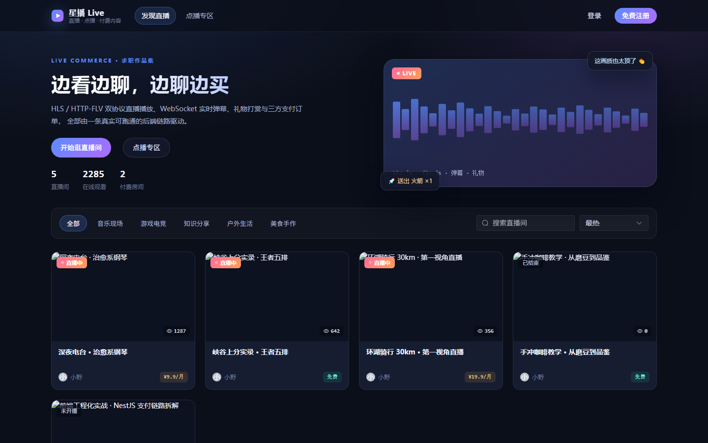
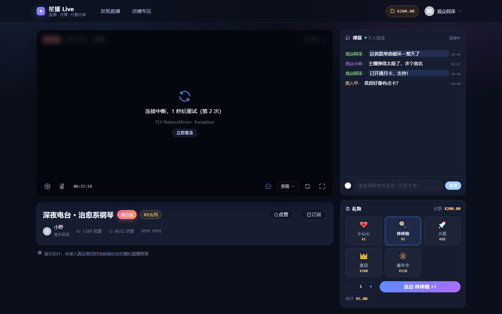
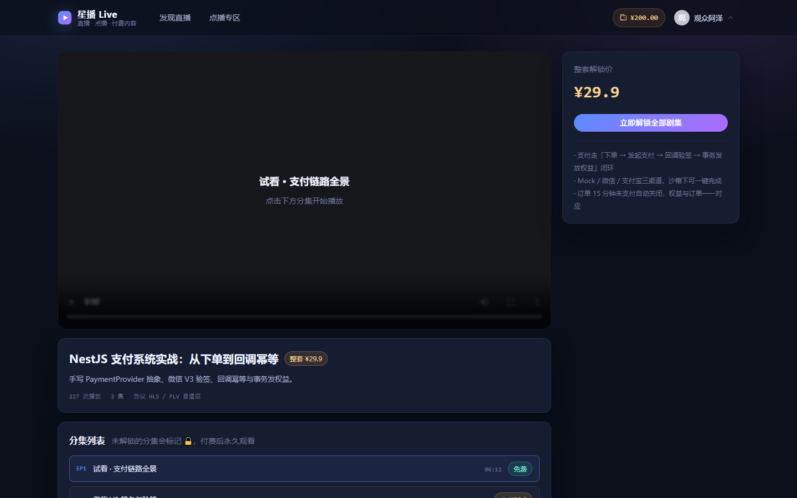
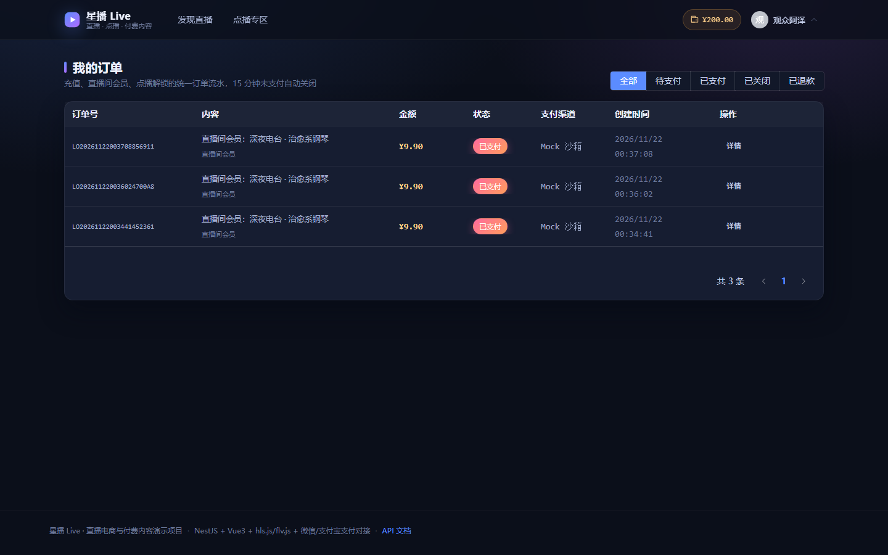
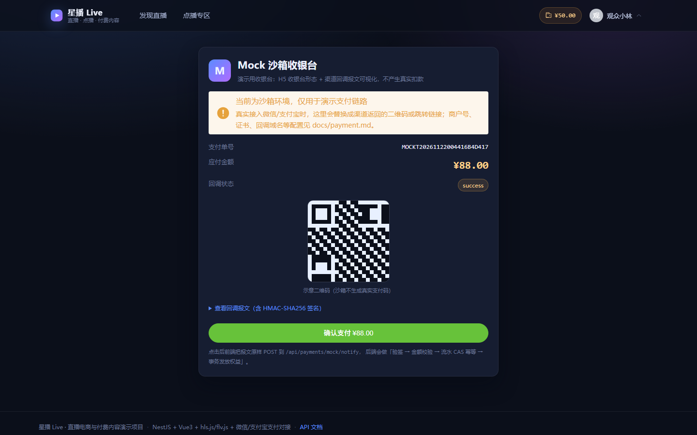
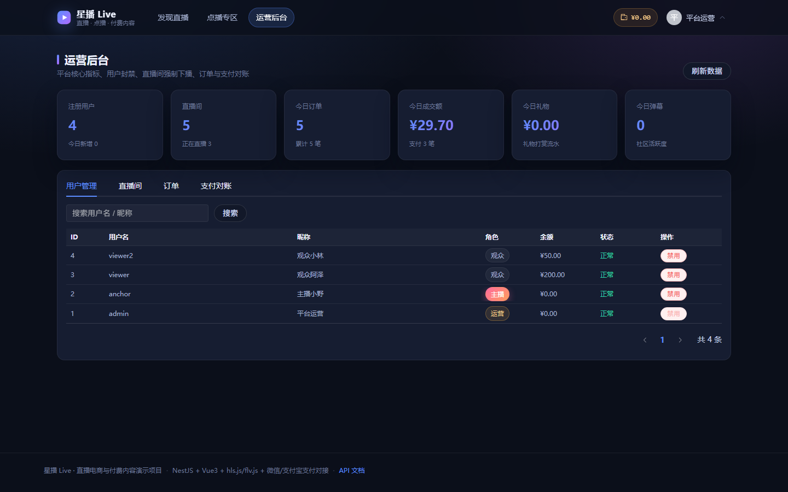
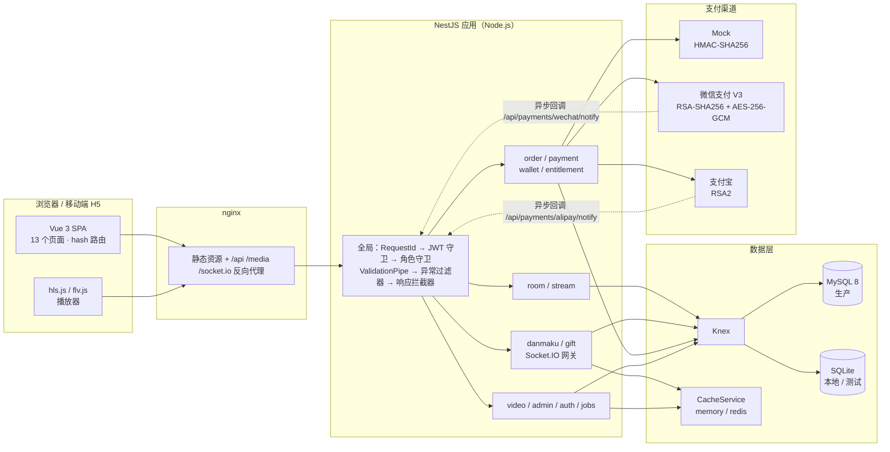

# 星播 Live · 直播电商与付费内容平台

一个**直播 + 点播 + 付费交易**的全栈演示项目：NestJS（Node.js）后端 + Vue 3 前端，覆盖直播播放（HLS / HTTP-FLV 双协议）、实时弹幕与礼物、下单扣库存式的会员/点播履约、微信/支付宝/Mock 三渠道支付对接（签名验签 + 回调幂等 + 退款 + 对账）。

`Node.js 20+` `NestJS 11` `TypeScript 5.8` `Knex 3` `MySQL 8 / SQLite` `Vue 3.5` `Vite 7` `Element Plus` `hls.js / flv.js` `Socket.IO` `JWT` `Docker`

## 界面预览

> 以下 6 张截图来自本项目的真实运行实例（`docker` 之外的本地模式：后端 `node dist/main.js` + 前端 `vite build` 产物，用 headless Edge 1440×900 抓取），
> 不是设计稿。生成方式见 [`docs/deployment.md`](./docs/deployment.md) 与 `scripts/serve-web.mjs`、`scripts/prime.html`。

| 首页 · 发现直播 | 直播间 · 播放器 + 弹幕 + 礼物 |
| --- | --- |
|  |  |

| 点播详情 · 分集与解锁 | 我的订单 · 支付流水 |
| --- | --- |
|  |  |

| Mock 沙箱收银台 · 回调报文 | 运营后台 · 指标与用户管理 |
| --- | --- |
|  |  |

## 为什么做这个项目

目标岗位是**深圳市业冕七数字科技「直播平台前后端（Vue / Node / Java / PHP）」**，JD 里有一条很直接的话：「完成直播播放 + 支付对接者薪资面议」。市面上讲直播的教程大多停在「能播出一个 flv」或「能弹出一条弹幕」，而真实直播平台的难点从来是**交易**：看播前的会员校验、下单后的库存与超时关单、支付回调的验签与幂等、退款后的权益回收、以及每天的对账。

所以这个项目刻意把「直播」和「钱」接在同一条链路上：

1. **直播播放是真的**：后端按房间状态与用户权益下发 HLS 多清晰度 + HTTP-FLV 兜底地址，并给播放地址签 token；前端 `LivePlayer.vue` 用 hls.js / flv.js 真实解码，未推流时降级为 Canvas 演示态（所以没有 CDN 也能录屏演示）。
2. **支付对接是真的**：不是「点一下变已支付」。微信支付 V3 的 RSA-SHA256 请求签名、平台证书验签、APIv3 AES-256-GCM 回调解密，支付宝的 RSA2 验签，都是真实实现；沙箱模式只是不发网络请求，密码学部分照跑。
3. **幂等是重点设计的**：Mock / 微信 / 支付宝三条回调路径共用同一套 `settle()`，靠「支付流水状态 CAS + 订单状态 CAS + 钱包业务号唯一键」三道闸门，重复回调只会发一次货。
4. **业务闭环完整**：主播开播 → 观众进房 → 付费解锁会员 → 弹幕互动 → 送礼 → 主播查看数据 → 运营后台看指标/对账/强制下播。
5. **工程化可交付**：20 张表的建表与索引、事务边界、e2e 测试、Docker 编排、nginx 部署配置、6 个模块的文档，全部齐备。

## 功能清单

- [x] **用户与鉴权**：注册/登录、JWT 双令牌（access 15min + refresh 7d）、refresh 轮换、登出黑名单、登录失败 5 次锁定 15 分钟、viewer / anchor / admin 三级角色守卫
- [x] **直播**：直播间创建与编辑、开播/下播状态机、分类与搜索排序、观看人数与点赞、进入房间记录观看历史
- [x] **直播播放**：`GET /api/streams/:id/play-info` 下发 HLS 多清晰度 + HTTP-FLV 双源与兜底顺序，播放地址带 HMAC token，未购买时返回锁定态
- [x] **弹幕**：WebSocket 实时收发、历史弹幕回放、敏感词拦截、屏蔽词打码、5 秒 5 条限流、管理员下架
- [x] **礼物**：礼物价目、余额扣款（CAS 防超扣）、幂等 requestId、飘屏动画、房间榜单、我的送礼记录
- [x] **点播**：剧集列表与详情、免费试看、未解锁不下发 playUrl、已购可播放并计数、前端 hls.js/flv.js 播放
- [x] **订单**：充值 / 房间会员 / 点播三种业务、幂等键去重、服务端定价、15 分钟超时自动关单、取消订单
- [x] **支付**：Mock / 微信支付 V3 / 支付宝三渠道抽象，统一下单、回调验签、事务内发货、退款、每日对账
- [x] **权益**：房间会员 31/366 天顺延、点播永久解锁、退款自动回收
- [x] **钱包**：余额、累计充值/消费、余额流水（充值/送礼/退款三类业务号唯一）
- [x] **主播后台**：我的直播间、开播/下播、推流地址与 OBS 参数、实时数据（观众/峰值/时长/点赞/礼物收入）
- [x] **运营后台**：核心指标、用户封禁、强制下播、弹幕下架、订单查询、支付对账
- [ ] 真实推流接入（SRS / nginx-rtmp）——当前为演示态播放源，见 [`docs/roadmap.md`](./docs/roadmap.md)
- [ ] 直播间商品橱窗与购物车（当前交易形态为会员 + 礼物 + 点播）
- [ ] Redis / MQ / 分库分表等规模化改造（已在 roadmap 中列出）

## 技术栈

| 层 | 技术选型 | 说明 |
| --- | --- | --- |
| 后端框架 | NestJS 11 + TypeScript 5.8 | 模块化、DI、守卫/拦截器/过滤器分层 |
| ORM / 查询 | Knex 3.1 | 手写迁移与查询构造，事务边界清晰可控 |
| 数据库 | SQLite（默认，better-sqlite3 12）/ MySQL 8（生产，mysql2） | 同一套 schema 双驱动，测试零外部依赖 |
| 鉴权 | @nestjs/jwt + 自研 TokenService | 双令牌、refresh 轮换、jti 黑名单 |
| 实时 | Socket.IO 4.8（`/ws` 命名空间） | 弹幕、礼物、上/下播广播 |
| 支付 | 自研 PaymentProvider 抽象 | Mock（HMAC-SHA256）/ 微信 V3（RSA + AES-GCM）/ 支付宝（RSA2） |
| 定时任务 | @nestjs/schedule | 关单、对账、清理过期令牌 |
| API 文档 | Swagger（`/api/docs`） | DTO + 装饰器自动生成 |
| 前端 | Vue 3.5 + TypeScript + Vite 7 | `<script setup>` + 组合式 API |
| UI | Element Plus 2.9（中文包 + 深色主题） | 表格、表单、抽屉、提示 |
| 状态 | Pinia | auth store（令牌、余额、角色） |
| 请求 | axios 封装（`frontend/src/api/http.ts`） | 统一信封解包、401 自动刷新重放、错误提示 |
| 播放器 | hls.js 1.6 + flv.js 1.6 | HLS 优先、FLV 低延迟兜底、Canvas 演示态 |
| 测试 | Jest 29 + ts-jest + supertest | 6 个 e2e 套件，真实 HTTP + 真实 SQLite |
| 部署 | Docker 多阶段 + docker-compose + nginx | MySQL / 后端 / 静态前端三服务 |

## 架构



关键链路（详见 [`docs/architecture.md`](./docs/architecture.md)）：

- **看播**：`POST /rooms/:id/enter` → `GET /streams/:id/play-info`（按权益决定 live/demo/offline + 签名地址）→ 前端 HLS/FLV 播放 → WebSocket 收弹幕/礼物。
- **付费**：`POST /orders`（幂等键 + 服务端定价）→ `POST /payments/create`（落 pending 流水）→ 渠道支付 → `POST /payments/{provider}/notify`（验签 → 金额校验 → 事务内 CAS 发货）→ 订单 paid + 权益/余额到账 + 前端刷新。

## 目录结构

```text
live-streaming-commerce-platform/
├─ backend/                       # NestJS 后端（72 个 ts 文件 / 6853 行）
│  ├─ src/
│  │  ├─ common/                  # 守卫、拦截器、过滤器、异常、DTO、工具
│  │  ├─ config/                  # 环境变量 → 强类型 AppConfig
│  │  ├─ database/                # Knex 工厂、20 张表迁移、种子数据
│  │  ├─ infra/cache/             # memory / redis 缓存抽象
│  │  ├─ modules/
│  │  │  ├─ auth/                 # 注册登录、令牌轮换、jti 黑名单
│  │  │  ├─ room/  stream/        # 直播间与播放地址
│  │  │  ├─ danmaku/ gift/        # 弹幕（含 Socket.IO 网关）与礼物
│  │  │  ├─ order/ payment/       # 订单、支付渠道、钱包、对账
│  │  │  ├─ entitlement/ video/   # 权益与点播
│  │  │  └─ admin/ jobs/          # 运营后台与定时任务
│  │  ├─ app.module.ts
│  │  └─ main.ts
│  └─ test/                       # 6 个 e2e 套件 + 测试装配器
├─ frontend/                      # Vue 3 前端（25 个 ts/vue / 8077 行）
│  ├─ src/
│  │  ├─ api/                     # axios 封装 + 类型 + 各域 API
│  │  ├─ components/              # LivePlayer / DanmakuPanel / GiftBar / PayDialog
│  │  ├─ router/                  # hash 路由 + 鉴权守卫
│  │  ├─ stores/                  # Pinia auth store
│  │  ├─ styles/main.css          # 深色主题变量与工具类
│  │  └─ views/                   # 13 个页面
│  └─ vite.config.ts
├─ db/                            # schema.mysql.sql（建表+索引）、seed.sql
├─ docs/                          # 6 份设计文档 + 支付说明 + 6 张截图
├─ nginx/default.conf             # 静态托管 + 反代 + WebSocket + Range 透传
├─ scripts/                       # 支付冒烟、静态预览服务、截图引导页
├─ docker-compose.yml             # MySQL + 后端 + nginx
└─ .env.example                   # 60+ 个环境变量示例
```

## 快速开始

前置：Node.js ≥ 20（验证用 24.x）、npm ≥ 10。**默认 SQLite，不需要装数据库**。

```bash
# 1) 安装依赖
cd backend && npm install
cd ../frontend && npm install
cd ..

# 2) 环境变量（全部有开发默认值，可跳过）
cp .env.example .env      # Windows: Copy-Item .env.example .env

# 3) 启动后端（自动建表 + 灌入演示数据）
cd backend
npm run build             # nest build → dist/
npm start                 # http://localhost:3000  · Swagger: /api/docs

# 4) 另开终端启动前端
cd frontend
npm run dev               # http://localhost:5173
```

打开 <http://localhost:5173>，即可看到首页直播间列表；点任意直播间进入播放页（演示态播放器 + 弹幕 + 礼物）。
生产构建与 docker 部署见 [`docs/deployment.md`](./docs/deployment.md)：

```bash
# 前端生产构建 + 本地静态预览（内置 /api 反代）
cd frontend && npm run build
cd .. && node scripts/serve-web.mjs --port 4173     # http://127.0.0.1:4173/#/

# 或者一键 MySQL + 后端 + nginx
docker compose up -d --build                        # http://localhost:8080
```

## 默认账号

首次启动（`SEED_ON_BOOT` 默认非生产为 true）会写入以下演示账号与 5 个直播间、3 部点播、5 个礼物：

| 角色 | 账号 | 密码 | 说明 |
| --- | --- | --- | --- |
| 观众 | `viewer` | `Viewer@123456` | 余额 ¥200，用于下单/送礼/看播演示 |
| 观众 | `viewer2` | `Viewer2@123456` | 余额 ¥50，用于余额不足、弹幕限流演示 |
| 主播 | `anchor` | `Anchor@123456` | 拥有 5 个直播间，可开播/查看推流信息 |
| 运营 | `admin` | `Admin@123456` | 运营后台、封禁用户、强制下播、对账 |

> 生产环境请设置 `SEED_ON_BOOT=false` 并替换所有密钥。

## 主要接口

统一响应信封：`{ code, message, data, requestId, timestamp }`；错误码见 [`docs/api.md`](./docs/api.md)。完整 Swagger 在 `/api/docs`。

| 分组 | 方法与路径 | 说明 |
| --- | --- | --- |
| 健康 | `GET /api/health` | 服务/数据库/直播模式/支付渠道自检 |
| 鉴权 | `POST /api/auth/register`、`login`、`refresh`、`logout` | 双令牌；`GET/PATCH /api/auth/profile` 查改资料 |
| 直播间 | `GET /api/rooms`、`GET /api/rooms/:id` | 列表（分类/搜索/排序/分页）、详情（含 `access` 购买状态） |
| 主播 | `POST /api/rooms`、`PATCH /:id`、`POST /:id/live/start`、`/:id/live/end` | 建房、开播、下播 |
| 播放 | `GET /api/streams/:roomId/play-info` | HLS/FLV 双源 + token + 锁定态 |
| 主播数据 | `GET /api/streams/:roomId/push-info`、`/stats` | 推流地址与 OBS 参数、实时观看数据 |
| 弹幕 | `GET /api/rooms/:roomId/danmaku` + WS `/ws` 事件 | 历史回放 + 实时收发 |
| 礼物 | `GET /api/gifts`、`POST /api/gifts/send`、`GET /api/gifts/leaderboard/:roomId` | 价目、赠送（幂等）、榜单 |
| 订单 | `POST /api/orders`、`GET /api/orders`、`GET /api/orders/:orderNo`、`POST /:orderNo/cancel` | 下单/列表/详情/取消 |
| 支付 | `GET /api/payments/providers`、`POST /api/payments/create`、`GET /api/payments/:outTradeNo` | 渠道列表、发起支付、查询 |
| 回调 | `POST /api/payments/mock/notify`、`/wechat/notify`、`/alipay/notify` | 验签 + 幂等发货 |
| 退款/对账 | `POST /api/payments/refund/:orderNo`、`POST /api/admin/reconciliation` | 管理员退款与对账 |
| 钱包 | `GET /api/wallet/me`、`GET /api/wallet/transactions` | 余额与流水 |
| 点播 | `GET /api/videos`、`GET /api/videos/:id`、`POST /api/videos/:id/episodes/:episodeId/play` | 未购不下发地址 |
| 权益 | `GET /api/entitlements/mine`、`/videos` | 我的会员与已购点播 |
| 运营 | `GET /api/admin/stats`、`users`、`orders`、`rooms`、`POST /rooms/:id/close` | 后台指标与处置 |

```bash
# 快速验证支付链路（后端已启动）
node scripts/smoke-payment.mjs
```

## 测试

后端 e2e 测试使用**真实 HTTP（supertest）+ 真实 SQLite 临时库**，每个套件独立建库、建表、灌种子，互不干扰，因此可以并行且不依赖任何外部服务：

```bash
cd backend
npm run typecheck      # tsc --noEmit（含 test/）
npm test               # jest，6 个套件并行
```

最近一次完整运行（本机 Windows / Node 24.20.0）：

```text
Test Suites: 6 passed, 6 total
Tests:       73 passed, 73 total
Time:        58.136 s
```

| 套件 | 用例数 | 覆盖内容 |
| --- | --- | --- |
| `backend/test/app.spec.ts` | 8 | 健康检查字段、请求 ID 回显、直播间列表分页、未登录 401、参数校验 400、未知路由 404、越权 403、后台看板 |
| `backend/test/auth.spec.ts` | 10 | 注册/登录/刷新令牌轮换/登出黑名单/伪造令牌/失败锁定/角色建房/资料更新 |
| `backend/test/room-live.spec.ts` | 19 | 分类、搜索排序、建房校验、开播/下播状态机、直播中改价拒绝、播放地址三种模式、推流信息与主播数据、进入房间计数、点赞、点播与礼物上下架 |
| `backend/test/order.spec.ts` | 11 | 充值/会员/点播下单、幂等键复用、跨用户幂等冲突、服务端定价、免费内容拒绝下单、列表与详情、取消订单 |
| `backend/test/payment.spec.ts` | 15 | 渠道列表、充值全链路（余额 200→300）、重复回调幂等、签名错误、时间窗过期、金额篡改、重复发起支付、超时订单、会员 31 天权益与续期、点播解锁、退款回收权益、对账 |
| `backend/test/danmaku-gift.spec.ts` | 12 | 弹幕历史与发送、敏感词拦截、屏蔽词打码、限流、管理员下架、送礼扣款、requestId 幂等、余额不足、榜单、下架礼物拒发 |

前端构建（含 `vue-tsc` 严格类型检查）：

```bash
cd frontend && npm run build     # 1774 modules transformed，构建通过
```

## 与岗位要求的对应关系

| JD 要求（原文关键词） | 本项目对应实现 | 代码位置 |
| --- | --- | --- |
| 「直播平台前后端开发，Node / Java / PHP」 | Node.js + NestJS 完整后端：12 个控制器、17 个服务、统一异常/响应/鉴权中间层 | `backend/src/main.ts`、`backend/src/app.module.ts`、`backend/src/modules/*` |
| 「熟练使用 MySQL，掌握建表、索引、事务」 | 20 张表的建表与索引设计；下单、支付发货、退款三处显式事务；状态 CAS 与唯一键兜底 | `backend/src/database/schema.ts`、`db/schema.mysql.sql`、`backend/src/modules/order/order.service.ts`、`backend/src/modules/payment/payment.service.ts` |
| 「JWT 鉴权」 | 双令牌（access + refresh）、refresh 轮换、jti 黑名单、角色守卫（viewer/anchor/admin）、登录失败锁定 | `backend/src/modules/auth/token.service.ts`、`backend/src/common/guards/jwt-auth.guard.ts`、`roles.guard.ts` |
| 「支付对接（微信 / 支付宝）」 | 统一 PaymentProvider 抽象 + 三渠道实现：Mock（HMAC）、微信 V3（RSA-SHA256 签名、平台证书验签、AES-256-GCM 解密）、支付宝（RSA2 验签）；回调验签、金额校验、幂等发货、退款、对账 | `backend/src/modules/payment/providers/wechat.provider.ts`、`alipay.provider.ts`、`mock.provider.ts`、`backend/src/modules/payment/payment.service.ts` |
| 「直播播放（flv.js / hls.js）」 | 后端下发 HLS 多清晰度 + HTTP-FLV 双源与兜底顺序、播放 token；前端 hls.js / flv.js 真实解码、清晰度切换、错误重试、Canvas 演示态 | `backend/src/modules/stream/stream.service.ts`、`frontend/src/components/LivePlayer.vue`、`frontend/src/views/VideoDetailView.vue` |
| 「Vue / React 前端」 | Vue 3 + TypeScript + Vite：13 个页面（首页/直播间/点播列表与详情/我的订单/收银台/模拟支付/个人中心与钱包/主播后台/运营后台/登录注册/404），hash 路由 + 鉴权守卫 | `frontend/src/views/*`、`frontend/src/router/index.ts` |
| 「axios 接口联调」 | axios 实例封装：令牌注入、401 自动 refresh 并重放请求、统一信封解包、错误提示 | `frontend/src/api/http.ts`、`frontend/src/api/index.ts` |
| 「直播平台业务」 | 直播间状态机、弹幕（WebSocket + 词表 + 限流）、礼物（余额 CAS + 幂等）、会员/点播权益、运营后台 | `backend/src/modules/danmaku/`、`backend/src/modules/gift/`、`backend/src/modules/room/`、`backend/src/modules/admin/` |
| 「前后端分离部署」 | Docker 多阶段构建 + docker-compose（MySQL/后端/nginx）+ nginx 反代与 WebSocket upgrade | `docker-compose.yml`、`backend/Dockerfile`、`frontend/Dockerfile`、`nginx/default.conf` |

## 后续规划

已完成范围、短期/中期/长期计划与已知技术债见 [`docs/roadmap.md`](./docs/roadmap.md)。摘要：

1. **短期**：真实推流联调（SRS/nginx-rtmp）、直播间商品橱窗与购物车、弹幕断线补拉；
2. **中期**：Redis 缓存与分布式锁、支付成功事件上 MQ、可观测性（trace/metrics）、CI/CD；
3. **长期**：多商户分账、直播回放转点播、推荐排序、移动端小程序；
4. **技术债**：词表审核、榜单实时查库、在线人数不衰减、沙箱对账数据。

## 文档

- [`docs/requirements.md`](./docs/requirements.md) — 需求与验收标准
- [`docs/architecture.md`](./docs/architecture.md) — 架构、时序图、状态机、设计决策
- [`docs/database.md`](./docs/database.md) — ER 图、表结构、索引与事务说明
- [`docs/api.md`](./docs/api.md) — 接口清单、错误码、WebSocket 事件
- [`docs/payment.md`](./docs/payment.md) — 支付渠道抽象与**正式接入配置清单**
- [`docs/deployment.md`](./docs/deployment.md) — 本地/生产/docker 部署与排错
- [`docs/roadmap.md`](./docs/roadmap.md) — 迭代计划与技术债

## License

[MIT](./LICENSE) © zhoushiba
