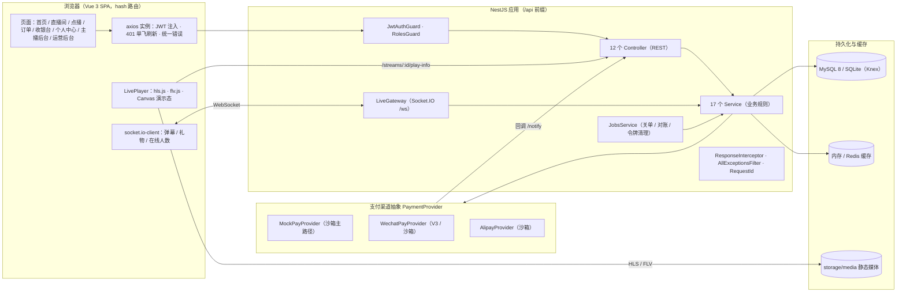
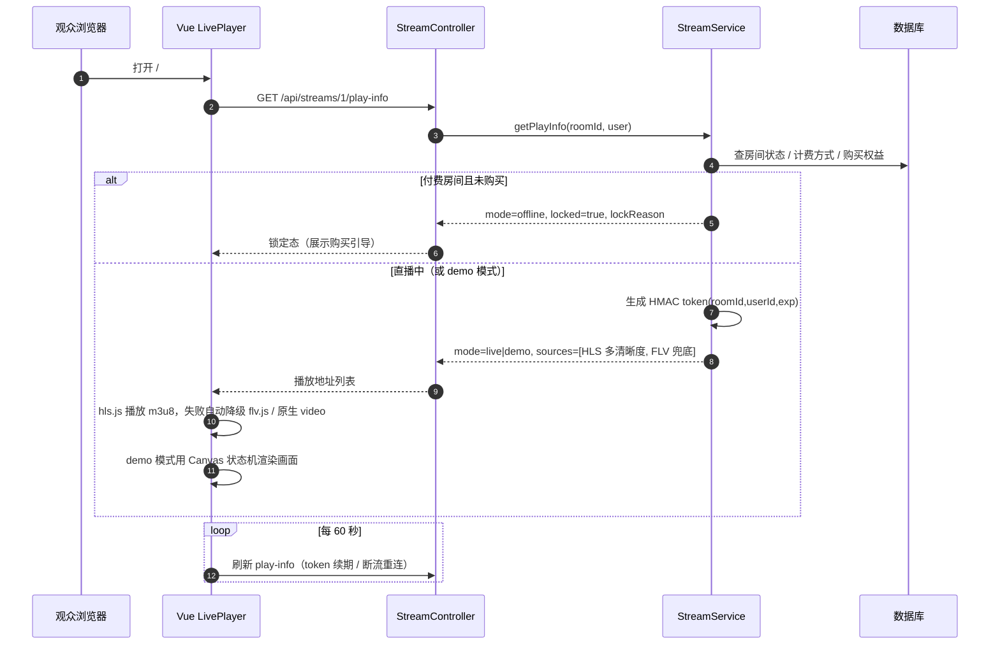
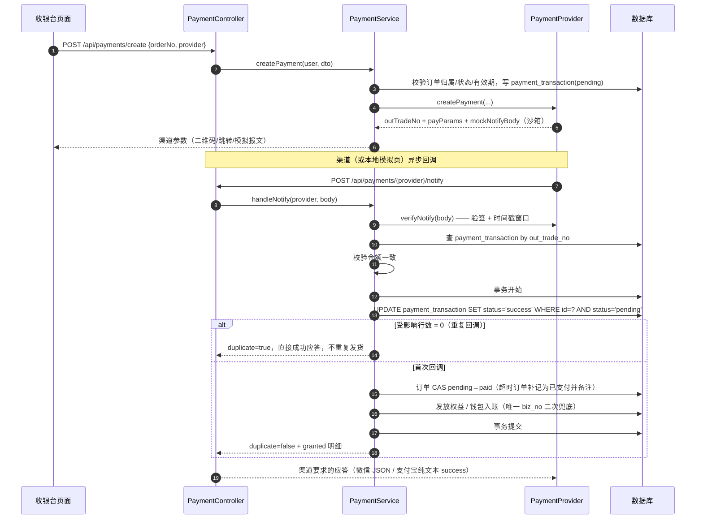
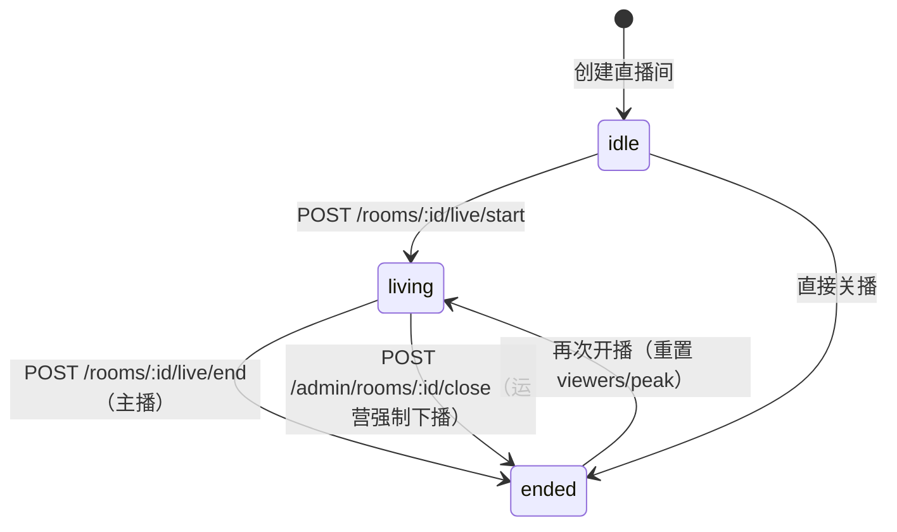
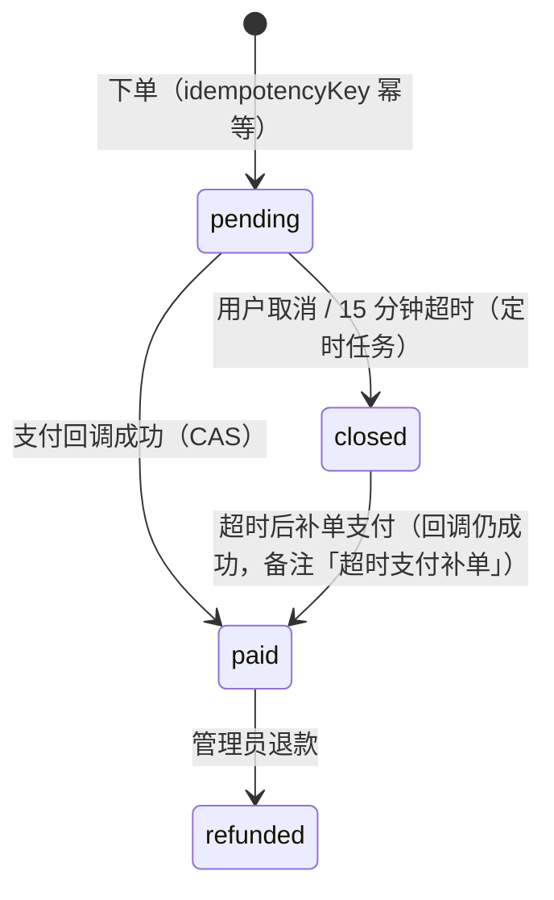

# 系统架构（architecture）

> 后端 NestJS 11（TypeScript）· Knex 3 + better-sqlite3 / mysql2 · JWT + Socket.IO · 前端 Vue 3.5 + Vite 7 + Element Plus + hls.js / flv.js

## 1. 总览



## 2. 后端分层

```
backend/src
├── main.ts                  # bootstrap：rawBody、全局前缀、静态媒体、Swagger、种子数据
├── app.module.ts            # 全局守卫/管道/过滤器/拦截器装配（顺序敏感）
├── config/                  # 环境变量装载 + 强类型 AppConfig（单例）
├── database/                # Knex 工厂、迁移（21 张表）、种子数据
├── infra/cache/             # CacheService：内存实现 + Redis 实现（失败自动降级）
├── common/                  # 错误码、BizError、响应信封、DTO、装饰器、工具函数
└── modules/                 # 按业务域切分，每个模块 controller + service + dto
    ├── auth/                # 注册登录、令牌签发/轮换/黑名单
    ├── room/                # 直播间、状态机、计费方式、进场/点赞
    ├── stream/              # 播放地址签发、推流信息、实时数据、健康检查
    ├── video/               # 点播剧集、解锁校验、播放计数
    ├── entitlement/         # 购买权益（房间会员 / 点播永久）
    ├── danmaku/             # 弹幕敏感词、限流、历史、下架
    ├── gift/                # 礼物目录、余额事务扣减、榜单
    ├── order/               # 订单创建（幂等）、定价、超时关单
    ├── payment/             # 支付渠道抽象、回调验签、幂等发放、对账、退款、钱包
    ├── admin/               # 运营看板与处置动作
    ├── jobs/                # 定时任务（每分钟关单、每日对账、每小时清理令牌）
    └── realtime/            # Socket.IO 网关（房间隔离 + 广播）
```

设计要点：

- **Controller 只做参数与鉴权**，业务规则全部在 Service，便于单测与复用（如 `settle()` 同时服务三个渠道）。
- **全局响应信封**：所有 REST 返回 `{code, message, data, requestId, timestamp}`；`@RawResponse()` 让微信/支付宝回调保持渠道要求的原始格式（避免包一层导致验签失败）。
- **错误码分层**：`9xxx` 通用、`1xxx` 鉴权、`2xxx` 房间、`3xxx` 订单、`4xxx` 支付、`5xxx` 钱包、`6xxx` 权益、`7xxx` 弹幕；前端可据此做差异化提示。
- **可替换基础设施**：Knex 一套代码同时跑 SQLite（本地/测试）与 MySQL（生产）；CacheService 内存/Redis 可切。

## 3. 直播播放时序



播放器策略：`hls.js`（MSE 播放 m3u8）→ 原生 HLS（Safari）→ `flv.js`（HTTP-FLV）→ Canvas 演示态，逐级降级，任何一级失败都不影响页面其它区域。

## 4. 支付回调时序（幂等核心）



## 5. 直播间状态机



约束：直播中禁止修改计费方式（`409/2003`）；非房主操作返回 `403/1006`；重复开播/未开播关播均返回明确文案。

## 6. 订单状态机



## 7. 前端结构

```
frontend/src
├── main.ts               # createApp + Pinia + Router + Element Plus（中文包）
├── App.vue               # 顶栏 / 钱包 / 用户菜单 / 页脚
├── router/index.ts       # hash 路由 + 登录守卫 + guestOnly + 标题
├── api/
│   ├── http.ts           # axios 实例、tokenStore、401 单飞刷新、统一错误提示
│   ├── index.ts          # 按域聚合的 API 方法（authApi/roomApi/.../adminApi）
│   └── types.ts          # 与后端一一对应的 DTO 类型
├── stores/auth.ts        # 用户态、isLogin/isAnchor/isAdmin、fetchProfile
├── components/
│   ├── LivePlayer.vue    # hls.js / flv.js / Canvas 三级降级播放器（1100 行）
│   ├── DanmakuPanel.vue  # WebSocket 弹幕 + 历史回放 + 频率提示
│   ├── GiftBar.vue       # 礼物面板 + 余额校验 + 充值引导
│   └── PayDialog.vue     # 下单 → 发起支付 → 回调 → 发放 的 5 步弹窗
└── views/                # 13 个页面（首页/直播间/点播/订单/收银台/模拟收银台/...）
```

13 个页面：首页、直播间、点播列表、点播详情、我的订单、收银台、模拟收银台、登录、注册、个人中心（资料/钱包/权益）、主播后台、运营后台、404。

## 8. 关键设计决策

| 决策 | 原因 |
| --- | --- |
| 金额统一用「元」的 `DECIMAL(12,2)`，Python 式分单位只在计算时借 `toCents` | 与 MySQL 列类型一致，避免展示层二次换算；`round2` 统一四舍五入 |
| 支付幂等放在 `payment_transaction` 的状态 CAS 上 | 唯一键只能防重复插入，不能防"同一流水被处理两次"，CAS 才能真正保证只发一次货 |
| 权益表 `purchase_entitlement` 唯一键 `(user_id,target_type,target_id)` | 同一用户对同一目标只有一条有效记录，续费按有效期顺延 |
| 播放地址带 HMAC token | 静态 HLS/FLV 文件无法用 JWT 保护，签发短时 token 并校验 `roomId/userId/exp` 更贴近真实 CDN 鉴权 |
| 演示模式（Canvas）与真实推流共用同一套 `play-info` 协议 | 无 OBS/FFmpeg 环境也能演示完整交互，接真实流只需改环境变量 |
| 前端 hash 路由 | 纯静态托管（nginx / 本地预览 / headless 截图）不需要服务端 rewrite，部署更简单 |
| 测试用 sqlite 临时库 | `npm test` 零外部依赖，CI 与本机都能一条命令跑完 |
