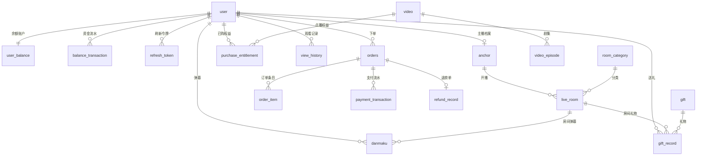

# 数据库设计（database）

> 生产：MySQL 8（InnoDB / utf8mb4 / utf8mb4_unicode_ci），建表脚本见 [`db/schema.mysql.sql`](../db/schema.mysql.sql)，种子数据见 [`db/seed.sql`](../db/seed.sql)。
> 本地与测试：SQLite（better-sqlite3），同一份 Knex schema 通过 `backend/src/database/schema.ts` 的 `migrate()` 幂等创建，因此 `npm test` 不需要外部数据库。
> 迁移代码：`backend/src/database/schema.ts`（导出 `TABLES` 常量，业务代码一律用常量而不是硬编码表名）。

## 1. ER 关系



## 2. 表清单（20 张）

| 表 | 作用 | 关键约束 |
| --- | --- | --- |
| `user` | 用户（观众/主播/运营） | `username` 唯一；`role` 枚举；`status` active/disabled |
| `user_balance` | 余额账户（与 user 1:1） | `user_id` 唯一；`balance >= 0` 由业务 CAS 保证 |
| `balance_transaction` | 资金流水（充值/消费/退款） | `biz_no` 唯一 —— 幂等兜底 |
| `refresh_token` | 刷新令牌 | `token_hash` 唯一（只存 sha256）；`revoked`、`expires_at` |
| `anchor` | 主播档案 | `user_id` 唯一；粉丝数、认证 |
| `room_category` | 直播分类 | 名称唯一 |
| `live_room` | 直播间 | `stream_key` 唯一；状态机 idle/living/ended |
| `video` | 点播视频 | 价格、上下架状态 |
| `video_episode` | 剧集 | `(video_id, episode_no)` 唯一；`free` 试看标记 |
| `purchase_entitlement` | 已购权益 | `(user_id, target_type, target_id)` 唯一；`expire_at` 为空表示永久 |
| `danmaku` | 弹幕 | `(room_id, id)` 索引；`status` visible/hidden |
| `gift` | 礼物目录 | 价格、特效、上下架 |
| `gift_record` | 送礼记录 | `request_id` 唯一 —— 幂等 |
| `view_history` | 观看记录 | `(user_id, room_id)` 组合唯一，累计观看时长 |
| `orders` | 订单 | `order_no` 唯一、`idempotency_key` 唯一、状态机 |
| `order_item` | 订单条目快照 | 标题/单价/数量，避免商品改价影响历史订单 |
| `payment_transaction` | 支付流水 | `out_trade_no` 唯一、`provider_trade_no` 唯一 |
| `refund_record` | 退款单 | `refund_no` 唯一 |
| `reconciliation_log` | 对账结果 | `(bill_date, provider)` 唯一，重复执行走 merge |
| `sys_config` | 系统配置 | `cfg_key` 唯一 |

金额字段一律 `DECIMAL(12,2)`（单位：元），时间字段 `DATETIME`，主键 `BIGINT UNSIGNED AUTO_INCREMENT`。

## 3. 索引说明（为什么这么建）

| 索引 | 表 | 支撑的查询 |
| --- | --- | --- |
| `idx_room_status_category(status, category_id)` | `live_room` | 首页「按分类看直播中房间」：`WHERE status='living' AND category_id=? ORDER BY viewers DESC` |
| `idx_room_anchor_status(anchor_id, status)` | `live_room` | 主播后台「我的直播间」与开播状态校验 |
| `idx_danmaku_room_id(room_id, id)` | `danmaku` | 进入直播间拉最近 N 条：`WHERE room_id=? AND status='visible' ORDER BY id DESC LIMIT ?` |
| `idx_order_user_status(user_id, status, created_at)` | `orders` | 我的订单按状态筛选 + 时间倒序（覆盖 `ORDER BY created_at` 的左前缀） |
| `idx_order_status_expire(status, expire_at)` | `orders` | 定时关单：`WHERE status='pending' AND expire_at < now LIMIT ?` |
| `idx_pay_order_no(order_no)` | `payment_transaction` | 支付成功回查订单的全部流水（一笔订单可多次发起支付） |
| `idx_pay_provider_status(provider, status, paid_at)` | `payment_transaction` | 日对账按渠道 + 状态 + 日期区间聚合 |
| `uk_episode_no(video_id, episode_no)` | `video_episode` | 剧集排序与唯一性 |
| `uk_entitlement_target(user_id, target_type, target_id)` | `purchase_entitlement` | 权益查询与"续费顺延"的定位键 |
| `uk_recon_date_provider(bill_date, provider)` | `reconciliation_log` | 同一天同一渠道只保留一份对账结果（onConflict merge） |

慢查询思路（按真实访问频次排序）：

1. **首页房间列表**是最高频读，`status+category` 组合索引把范围缩到"直播中"这一小集合，再按观看人数排序；房间总数在上万级时该索引仍可走 `LIMIT` 提前终止。
2. **我的订单**用 `(user_id, status, created_at)`，避免 `ORDER BY created_at` 触发 filesort；不带状态时走 `user_id` 前缀。
3. **定时关单**用 `(status, expire_at)`，每分钟只扫过期待支付订单，不会全表扫。
4. **弹幕历史**用 `(room_id, id)`，按主键倒序取 50 条后反转为正序返回。
5. **对账**扫的是「某天某渠道」的支付成功流水，`(provider, status, paid_at)` 可精确命中区间。

> 所有业务查询都用 Knex 参数化，避免 SQL 注入；`DB_LOG_SQL=true` 可在本地打印实际 SQL 做 EXPLAIN。

## 4. 事务边界（3 处核心事务 + 2 处并发/幂等）

### 事务 1：下单（`backend/src/modules/order/order.service.ts`）

```ts
await this.db.transaction(async (trx) => {
  const [orderId] = await trx(TABLES.order).insert({ order_no, user_id, biz_type, ... });
  await trx(TABLES.orderItem).insert({ order_id: orderId, title, price, ... });
});
```

- 订单抬头与订单条目必须同时成功，否则回滚；
- `order_no` / `idempotency_key` 唯一键冲突时回读已有订单，视为幂等命中（`idempotent: true`）。

### 事务 2：支付回调发放权益（`backend/src/modules/payment/payment.service.ts` → `settle()`）

```ts
await this.db.transaction(async (trx) => {
  const affected = await trx(TABLES.paymentTransaction)
    .where({ id: tx.id, status: 'pending' })
    .update({ status: 'success', paid_at: paidAt, provider_trade_no, notify_payload });
  if (affected === 0) return { duplicate: true, granted: [] };   // 重复回调，直接返回
  const { order, transitioned } = await this.orderService.markPaid(trx, tx.order_no);
  if (!transitioned) return { duplicate: true, granted: [] };
  await this.grantForOrder(trx, order);                          // 钱包入账 / 发放权益
});
```

### 事务 3：退款（`payment.service.ts` → `refund()`）

事务外先调渠道退款，事务内：订单 `paid → refunded` 的 CAS + 写 `refund_record` + 支付流水置 refunded + 回收权益或扣回充值余额。

### 并发/幂等 1：余额扣减（`gift.service.ts`）

```ts
const affected = await trx(TABLES.userBalance)
  .where({ user_id })
  .andWhere('balance', '>=', amount)
  .update({ balance: trx.raw('balance - ?', [amount]), updated_at: new Date() });
if (affected === 0) throw BizErrors.insufficientBalance();
```

单条 `UPDATE ... WHERE balance >= ?` 由数据库行锁保证原子性，永远不会扣成负数，也不需要先查再改（避免 check-then-act 竞态）。

### 并发/幂等 2：支付回调唯一约束 + 状态 CAS

- 唯一约束：`payment_transaction.out_trade_no` 唯一、`balance_transaction.biz_no` 唯一（`recharge:<orderNo>` / `gift:<requestId>` / `refund:<refundNo>`）、`gift_record.request_id` 唯一、`orders.idempotency_key` 唯一；
- 状态 CAS：`UPDATE ... WHERE status='pending'` 命中 0 行就认为已处理过，直接应答成功但不重复发货。

## 5. 本地与生产的差异

| 项 | SQLite（本地/测试） | MySQL 8（生产） |
| --- | --- | --- |
| 客户端 | `better-sqlite3` | `mysql2` |
| 迁移 | `migrate()` 启动时自动建表（`DB_AUTO_MIGRATE=true`） | 同左，或直接执行 `db/schema.mysql.sql` |
| PRAGMA | `foreign_keys=ON`、`journal_mode=WAL`、`busy_timeout=5000` | 不需要 |
| 连接池 | `min=1,max=1`（避免 sqlite 写锁竞争） | 默认 `min=2,max=10` |
| 建表附加 | 无 | `ENGINE=InnoDB CHARSET=utf8mb4 COLLATE=utf8mb4_unicode_ci` |

## 6. 种子数据

`backend/src/database/seed.ts` 在非生产环境启动时幂等写入（已存在则跳过）：

- 4 个账号：`admin` / `anchor` / `viewer`（余额 200）/ `viewer2`（余额 50）；
- 5 个分类、5 个直播间（3 个直播中、1 个未开播、1 个已结束）、5 种礼物；
- 3 部点播视频（含免费试看集）、4 条历史弹幕、2 条礼物记录、4 条系统配置。

手动重置：`npm run db:reset`（删库重建 + 重新种子）；只补种子：`npm run db:seed`。
